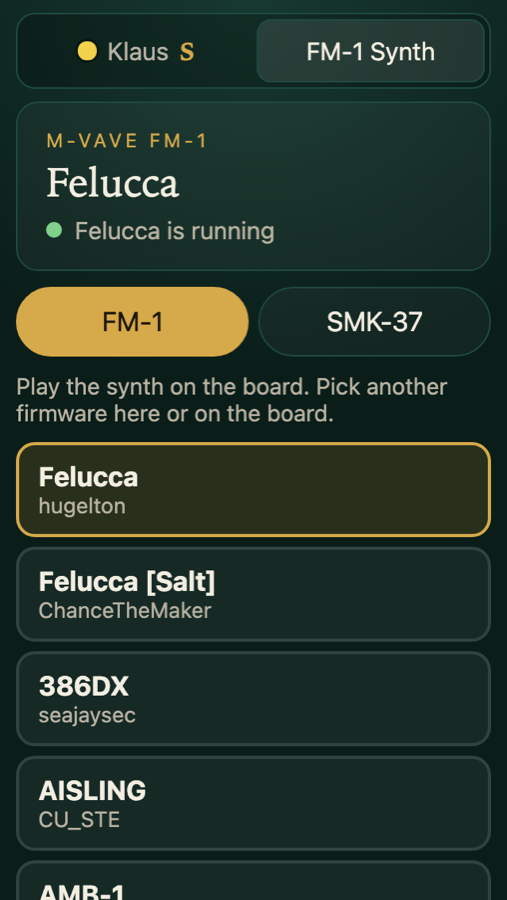

# FM-1 Synth for Game Table

[](https://github.com/klaushofrichter/synth-game/actions/workflows/checks.yml)
[](https://github.com/klaushofrichter/synth-game/actions/workflows/checks.yml?query=event%3Aschedule)
<!-- Static assertion: GitHub publishes no endpoint for alert status. -->
[](https://github.com/klaushofrichter/synth-game/security/dependabot)

<!-- No release badge: this repo cuts no releases; tables run whatever the production branch holds, and the game's
     version is in its manifest. No version numbers in this text either: they go stale. -->

A pocket synthesizer as a game for [Game Table](https://github.com/klaushofrichter/games-service): the **M-VAVE FM-1**
(or its 37-key sibling, the **SMK-37**), emulated in the table's board, with any of the community's firmwares on it.
One player sits at the table and plays the synth on the board by touch; their phone picks firmwares and ends the
session. More about Game Table, its tables and its other games: **[games.skylar.technology](https://games.skylar.technology)**.


The emulator is **[fm1-emu](https://github.com/joakimeriksson/fm1-emu) by Joakim Eriksson** and its contributors: it
emulates the FM-1's CPU, screen, keys, knobs and audio so the firmwares run unchanged. This repository is a copy of it
that keeps its whole source and history (MIT, see [LICENSE](LICENSE)) and adds the game. The emulator's own README,
with everything about the emulator, its browser page, its desktop app and its plugin, is
**[FM1-EMU.md](FM1-EMU.md)**. The firmwares are their authors' work: the game hosts none and downloads each from its
author's site when it is picked, the same package one would install on a real FM-1.

## The game



- **One player, at the table.** The lobby works as for every game: join with the QR code, mark ready, start. The player
  sits on South.
- **The board** shows the device's front panel and the platform's own controls (seat plate, settings, Lobby). Keys,
  knobs, buttons, pads and faders are played by touch, with as many fingers as you like. There is no keyboard, MIDI or
  other device to connect.
- **Firmware…** on the board opens a window with every firmware of the device; its FM-1 and SMK-37 tabs switch the
  board between the devices, as the phone's two buttons do.
- **The board's settings** (the gear) have the device, the volume, the emulated clock and Restart. The game setting
  *Device to start with* picks the device before the start.
- **The phone** (right) shows what runs, the firmware list, the two devices and **Finish**, which ends the session
  with a summary of what was played.
- **The turn button** faces the game north for a reader on the other side: the bar, the panel and the seat plate turn
  in place.
- **Saves:** patches and settings a firmware saves with its own controls stay in the table's browser, per firmware.
- **Remote players and watchers** see what is played, but the emulator and its sound run only on the table's own
  board.

<br clear="right">

The rules for players are [`games/fm1-synth/how-to-play.md`](games/fm1-synth/how-to-play.md); the decisions behind the
game are in [`docs/decisions.md`](docs/decisions.md).

## How the game gets onto a table

```
synth-game (this repo, branch production)
   │  the Game Table service fetches the games/ folder as one bundle
   ▼
the service's console: Game repositories, and per table a checkbox for each repository
   ▼
table PC: downloads the bundle over its own link, adds FM-1 Synth to the lobby between games
```

A table gets the game's folder exactly as it is in the repository, with no build step, so the emulator's build (the
wasm, its audio worklet and the firmware lists) is committed in `games/fm1-synth/assets/emu/`.
`tools/build_game.sh` makes it from the emulator's source, and a test fails while it is older than that source.

## Layout

| Path | What it is |
| --- | --- |
| `games/fm1-synth/` | The game, as games-service's developer guide describes a game: `manifest.json`, `rules.ts`, `board.js`, `deck.js`, their CSS, `how-to-play.md`, and `assets/` (`synth.js`, the emulator on the board; `emu/`, the built emulator and catalogs). Only `games/` goes to tables. |
| `tools/build_game.sh`, `scripts/emu-source.mjs` | Build the emulator into the game's assets; what the build is made from, for the test that keeps it current |
| `games-service.ref` | The games-service branch, tag or commit the game is tested against |
| `scripts/games-service.sh` | Brings games-service into `.games-service/` (git-ignored) for the tests; `npm run setup` runs it |
| `tests/` | Vitest: the rules on games-service's own runtime (`fm1-synth.test.ts`), the bundle path the console and tables take and the rules for players (`bundle.test.ts`), the committed emulator build (`assets.test.ts`) |
| `scripts/e2e/` | The browser check (Playwright): a real Table Host, the board and a phone, from the lobby to the result, with both devices and the board turned north; uses games-service's e2e helpers |
| `docs/decisions.md` | Decisions for the game (E-nnn) |
| everything else | The emulator, from upstream: `crates/` (Rust: the CPU, chip, desktop app, wasm), `web/` (its browser page), `tools/`, `docs/`, … See [FM1-EMU.md](FM1-EMU.md). |

## Building and testing

Requires Node.js 26, Python 3 for the browser check, and Rust with the `wasm32-unknown-unknown` target to rebuild the
emulator.

```sh
npm ci
npm run setup                         # = scripts/games-service.sh; GAMES_SERVICE_DIR=../games-service uses a local
                                      # checkout, GAMES_SERVICE_REF=<ref> another branch or tag
npm test                              # rules, bundle, rules for players, the committed emulator build
npm run typecheck
tools/build_game.sh                   # after an emulator change or a catalog refresh: rebuild games/fm1-synth/assets/emu
pip install -r scripts/e2e/requirements.txt && python -m playwright install chromium
scripts/e2e/run-all.sh out/           # board + phone in a real browser; screenshots in out/ (needs the internet:
                                      # the firmwares come from their authors' sites)
```

A change in the game's folder takes a new calendar version (`YYYY.MM.DD.N`):
`node .games-service/scripts/check-game-versions.ts --base origin/main --fix`; the PR checks enforce it.

## Playing it locally

On a table of your own, without the Game Table service, from a games-service checkout next to this one:

```sh
CLOUD_URL= scripts/local-table.sh --offline --extra ../synth-game
```

The board opens at `http://localhost:8080/board/`. The emulator's sound needs a secure page, which the board at
`localhost` is (a board opened at the computer's network address is not). Without a phone, the board's *Developer
settings › Play from the board* puts the player's phone beside the board.

## Keeping up with the emulator

Upstream (`joakimeriksson/fm1-emu`, branch `master`) is merged into `main` from time to time; its files stay as they are
here so the merges stay simple. After a merge: carry upstream's README changes into `FM1-EMU.md` (its README is that
file here), rebuild the game's emulator (`tools/build_game.sh`), run the tests, and give the game a new version.
Upstream's own workflows (its web page, releases and plugin builds) are not carried: this repository publishes only
the game. See [`CLAUDE.md`](CLAUDE.md) for the steps.

## Branches and checks

```
feature branch → PR → main → (PR) → production → tables, at the console's next fetch
```

`checks.yml` runs `test` (on pull requests the game-version check, then the tests, the typecheck and
`npm audit --audit-level=high`), `e2e`, `emulator` (the emulator's own Rust and browser tests) and `codeql` on every PR to
`main` or `production` and every push to `production`, and weekly (Mondays) against games-service `main` instead of the
pinned ref, so a platform change that breaks the game shows up here first. `production` is the branch to protect with
those checks, since that is what tables run.

## Licence

[MIT](LICENSE). The emulator is Copyright (c) 2026 Joakim Eriksson; the game (`games/`, `tests/`, `scripts/`,
`tools/build_game.sh`) is Copyright (c) 2026 Klaus Hofrichter. The firmwares are not part of this repository; each has
its author's own licence.
