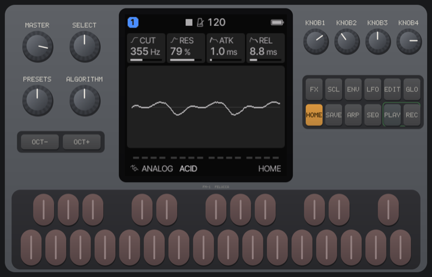

# FM-1 Synth

Play a pocket synthesizer on the board: an emulated M-VAVE FM-1 (or its big sibling, the SMK-37), with any of the
community's firmwares on it.

## In short

- One player, sitting at the table. The synth is on the board: play its keys, knobs and buttons by touch, with as many
  fingers as you like.
- **Device to start with** picks the FM-1 or the SMK-37; switch between them any time during the game.
- **Firmware…** on the board, or the list on your phone, switches to another firmware. Each is downloaded from its
  author's site, so the table needs the internet.
- **★** on a firmware stars it; starred ones come first, newest star first. Your phone keeps them for next time.
- **Finish** on your phone ends the session.

## Playing

- **Keys** sound while you hold them; slide along them for a glissando.
- **Knobs** turn when you drag up or down on them.
- **Buttons** work like the real ones: every firmware uses them in its own way, as its author describes it.
- The first time, tap the synth once to turn its sound on.

## Switching the device

The setting **Device to start with** is fixed once the game runs, but the board can switch any time: tap the
**FM-1** or **SMK-37** tab in **Firmware…**, or choose the **Device** in the board's settings. The board starts that
device on its first firmware; pick another from its list. Your phone has the same two buttons.

## Favorites

Tap the **☆** on a firmware, in the board's **Firmware…** window or in your phone's list, to star it; tap the **★**
again to take the star away. The next time the list opens, starred firmwares come first, the newest star at the top.
The stars are kept in your phone's browser, so they come back with you for the next game at this table. Another
player who takes your seat brings their own.

## Settings on the board

The gear button on the board has the device, the volume, the emulated clock (100 MHz plays nearly every firmware; the real device
runs at 240 MHz) and **Restart** for the firmware. When the table's sound is off, the synth is silent too.

## Saved sounds

Patches and settings a firmware saves (with its own save button) stay on this table for the next time you play that
firmware.

> Remote players and watchers see what is played, but the synth and its sound stay at the table.
